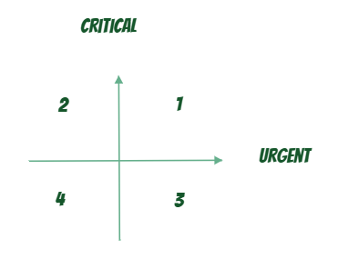

# Minutes of Meeting

| Information | Details |
| :--- | :--- |
| **Purpose:** | Analyze customer problems, define Homework Management System scope, and assign use case diagrams. |
| **Meeting Title:** | Customer Problem Analysis & Use Case Planning — Homework Management System |
| **Date:** | 13/10/2026 |
| **Time:** | 20:30 - 22:45 |
| **Duration:** | 2 hours 15 minutes |
| **Location:** | Discord |
| **Facilitator:** | Thinh |
| **Note Taker:** | Thinh |
| **Attendees:** | Thinh, Nguyen Phuc, Thang |

---

## 1. Discussion Points

| Topic | Summary |
| :--- | :--- |
| **Domain & stakeholders** | Domain: Education. Primary stakeholders: lecturers and students. Contexts: in-person classes, Zoom, and Discord. Homework can be individual or group-based. |
| **Business model / workflow** | Workflow: lecturer hands out homework → student completes it → student submits → lecturer grades → lecturer provides feedback → system stores score. Key costs: time, effort, and opportunity cost. |
| **Pain points** | Identified: Data Fragmentation (4), time consuming (2), easy to forget (1), no privacy (1). Team used Eisenhower Matrix and prioritized **easy to forget**. |
| **Proposed solution** | Create homework with deadlines/reminders; assign homework to classes/groups; show homework/deadlines on calendar; support submission and grading. |
| **Use case scope** | Lecturer: Homework CRUD, set deadline, set reminder, Class/Group CRUD, assign class/group, grade homework. Student: submit homework. Shared: view calendar. |

### Eisenhower Matrix

---

## 2. Decisions Made

| Decision | Rationale |
| :--- | :--- |
| **Select Homework Management System** | Solves fragmented homework-management workflow across in-person and online learning platforms. |
| **Prioritize Easy to forget** | Reminders, deadlines, and calendar reduce missed homework and late submissions. |
| **MVP scope** | Homework CRUD; deadlines/reminders; class/group CRUD; assignment; submission; grading; calendar. |
| **Complete customer problem analysis** | Team finalized domain, business model, pain points, Eisenhower prioritization, and proposed solution. |
| **Split use case diagrams by function** | Each work item has a clear owner; Thang owns class/group assignment use case. |

---

## 3. Completed Items

| Item | Owners | Status |
| :--- | :--- | :--- |
| Analyze domain and stakeholders | Thinh, Nguyen Phuc, Thang | Done |
| Analyze homework business model | Thinh, Nguyen Phuc, Thang | Done |
| Validate pain points and evidence | Thinh, Nguyen Phuc, Thang | Done |
| Prioritize pain points with Eisenhower Matrix | Thinh, Nguyen Phuc, Thang | Done |
| Propose Homework Management System solution | Thinh, Nguyen Phuc, Thang | Done |
| Consolidate customer problem analysis | Thinh, Nguyen Phuc, Thang | Done |

---

## 4. Action Items

| Action Item | Owner | Due Date | Status |
| :--- | :--- | :--- | :--- |
| Use case diagram: Manage homework (CRUD) | Nguyen Phuc | 16/10/2026, 23:59:59 VNT | Backlog |
| Use case diagram: Set deadline and reminder | Nguyen Phuc | 16/10/2026, 23:59:59 VNT | Backlog |
| Use case diagram: Manage class and group | Thinh | 16/10/2026, 23:59:59 VNT | Backlog |
| Use case diagram: Assign homework to class/group | Thang | 16/10/2026, 23:59:59 VNT | Backlog |
| Use case diagram: Submit homework | Thinh | 16/10/2026, 23:59:59 VNT | Backlog |
| Use case diagram: Grade homework | Thang | 16/10/2026, 23:59:59 VNT | Backlog |
| Use case diagram: View homework calendar | Thinh | 16/10/2026, 23:59:59 VNT | Backlog |
